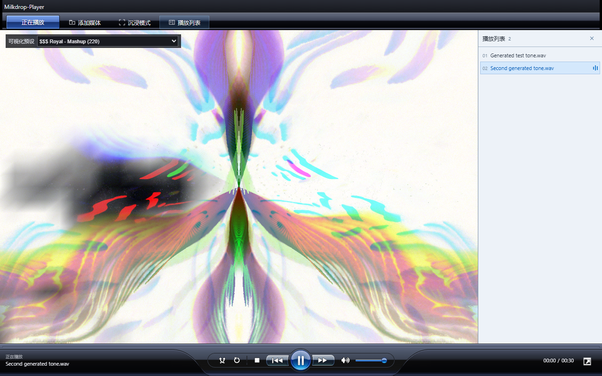

# Milkdrop-Player

一个采用复古 WMP 玻璃控件的浏览器媒体播放器。选择本地音频或视频即可播放，音乐可驱动 Butterchurn 可视化。

[English](README.md) · [参与贡献](CONTRIBUTING.md) · [授权状态](docs/LICENSING.md)



**发布状态：** 应用与仓库配套文件已在本地准备。上游 WMP 组件和 SVG 素材的再分发授权仍需确认。MIT 仅覆盖 Mazko 的原创贡献，分发前请阅读[第三方声明](THIRD_PARTY_NOTICES.md)。

## 启动

下载完整目录，用较新的桌面 Chrome 或 Edge 打开 `index.html`。保留相邻的 JavaScript、CSS、SVG 和 `vendor/` 文件。日常播放不需要安装依赖或构建。

安装 Node.js 22 或更新版本后，也可以启动本地服务：

```sh
node scripts/serve.mjs
```

访问 [http://127.0.0.1:8080](http://127.0.0.1:8080)。可通过环境变量 `PORT` 调整端口。

## 使用方法

1. 点击“添加媒体”，选择一个或多个本地音频/视频文件。
2. 点击播放列表条目切歌，使用底部控件播放、暂停、调整进度/音量、随机或循环播放。
3. 音频播放时可以选择可视化预设。当前附带的预设包包含 100 个选项。
4. 点击“沉浸模式”展开画面，播放时闲置 3.5 秒后淡出控件，鼠标移动或键盘聚焦时恢复；退出后还原先前列表状态。
5. 手机端默认收起列表，可打开抽屉，通过关闭按钮、遮罩或 Escape 关闭。底栏显示真实文件名和已播放/总时长。
6. 点击右下角控件进入全屏。全屏时自动隐藏列表，退出后恢复先前的列表显示状态。

当前界面为简体中文。列表条目、工具栏和原生下拉框支持键盘聚焦。媒体播放及全屏仍受浏览器权限限制。

## 当前功能

- 通过浏览器原生解码器播放本地音视频。
- 使用本地固定版本依赖运行 Butterchurn 音频可视化。
- 播放列表、进度、音量、随机和循环控制。
- 响应式工具栏及播放列表，已检查 320px / 390px 窄屏布局。
- 暂停及页面可见性变化时停止可视化渲染；视频播放时不运行音频可视化循环。
- 播放/依赖失败提示。可视化库缺失时仍能导入和播放音频。

页面没有媒体上传、账号、统计或持久化功能。文件引用和播放列表只保存在当前页面会话中，刷新后清空。详见[隐私说明](PRIVACY.md)。

## 兼容性与限制

本地运行验证使用 Windows 桌面 Microsoft Edge，CI 配置为 Linux Chromium。其他浏览器及真实移动设备仍需验证，尤其是 Web Audio、WebGL、全屏、CSS 嵌套和 `ElementInternals.states`。

扩展名不代表浏览器一定支持文件中的编码。本地检查过 WAV 音频和 WebM 视频，MP3、AAC、FLAC、MP4 等格式取决于浏览器、系统及编码支持。目前不提供 DRM 解码、流媒体平台接入、歌词、标签解析或播放列表持久化。

完整下载后可离线运行。访问 GitHub Pages 时仍会向 GitHub 请求页面资源；项目没有 Service Worker，也没有可安装 PWA 功能。

## 开发与验证

开发需要 Node.js 22+ 和 npm，播放页面本身不需要这些工具。

```sh
npm ci --ignore-scripts
npm run check
npm test
npx playwright install chromium
npm run test:browser
npm run build
```

Linux 可能需要使用 `npx playwright install --with-deps chromium` 安装浏览器和系统依赖。本地使用已安装的 Edge 测试时，在 shell 中设置 `PLAYWRIGHT_CHANNEL=msedge`。测试自动生成音频，不包含商业歌曲。

构建命令会重新生成 `dist/`，只复制播放器及必要授权文件，排除备份、开发依赖、测试和仓库元数据。`npm run release:check` 单独检查发布信息，在上游授权及仓库信息未填写完成前会按预期失败。

相关文档：[架构与文件职责](docs/ARCHITECTURE.md)、[测试说明](docs/TESTING.md)、[发布步骤](docs/RELEASING.md)、[变更记录](CHANGELOG.md)。

## 来源与许可

项目集成和维护：[Mazko / mazkosoft](https://github.com/mazkosoft)。

- 播放器组件和 WMP 风格 SVG/CSS 来自 [DavidJCobb/wmp-svg](https://github.com/DavidJCobb/wmp-svg)，其中播放器和布局已做本地修改。当前检查的上游版本未找到明确的再分发许可证。
- 可视化引擎：[jberg/butterchurn](https://github.com/jberg/butterchurn)，2.6.7，MIT。
- 可视化预设：[jberg/butterchurn-presets](https://github.com/jberg/butterchurn-presets)，2.4.7，附上游 MIT 声明。

[LICENSE](LICENSE) 仅适用于 Mazko 的原创贡献，不授予上游 WMP 代码、SVG、其他第三方内容及商标的权利。请保留[第三方声明](THIRD_PARTY_NOTICES.md)及 `vendor/` 中的许可证。

这是独立项目。Windows Media Player 和 Microsoft 名称只用于说明视觉灵感，不代表关联或官方认可。仓库不附带歌曲和视频文件。

## UI

当前界面保留黑色紧凑导航和蓝色选中标签，底部使用 wmp-svg 原版深色播放控件与弧形底座。[UI 来源说明](docs/DESIGN_REFERENCE.md)。
